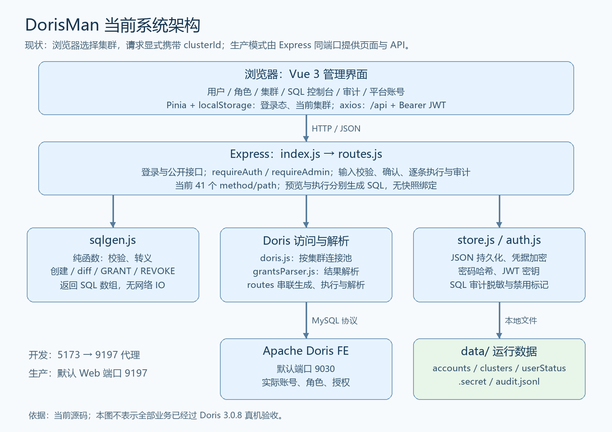
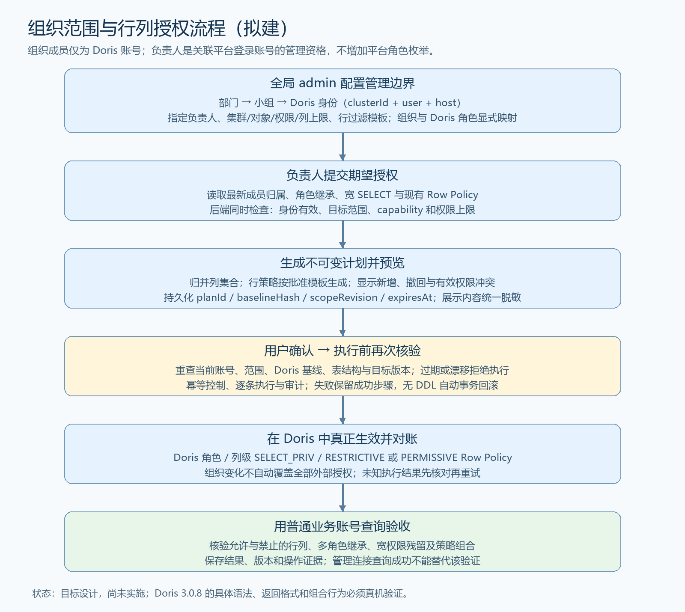

# DorisMan 项目现状与功能扩展设计方案

**文档版本**：v1.0

**日期**：2026-11-27

**代码基线**：本地 HEAD `49bf161`，软件 `0.1.2`

**状态**：现状已完成代码核查与本地验证；扩展部分为待实施设计，Doris 3.0.8 真机兼容性待验证。

**范围**：项目代码、业务逻辑、组织管理、行列权限、安全审计、关于/帮助和开发验收；本次不实施业务功能、不发布程序。

## 结论与阅读导航

项目已具备可构建的 Doris 授权管理基础：Vue 管理界面、Express API、Doris SQL 生成与授权解析、多集群连接和 JSON 本地持久化。现有自动测试为 **88/88 通过**，完整 build 成功；这不等于全部业务闭环或 Doris 3.0.8 验收已通过。

本轮扩展围绕“组织中的 Doris 账号 → 角色 → 表/列授权与行策略”展开。部门、小组不等同于 Doris 角色；平台 `admin/readonly` 与 Doris 角色也不是同一体系。负责人用平台账号登录，通过独立的管理范围获得受限操作资格。

需要先处理几处基础问题：登录明文降级、JWT 无即时撤销、角色删除参数不匹配、审计遗漏、预览与执行缺乏快照绑定，以及授权 diff 的顺序/重复目标问题。扩展时必须把有效权限核查和实际业务账号查询纳入验收。

| 阅读目的 | 章节 |
| --- | --- |
| 理解已有系统 | 需求、总体架构、代码地图、现有模块与接口 |
| 定位问题 | 现状差异与风险清单 |
| 开始新增功能 | 组织管理、行列权限、安全、关于/帮助目标设计 |
| 规划实施与交付 | 数据与接口增量、迁移回滚、实施顺序、测试验收 |

## 需求分析、目标与边界

### 已确认的本轮需求

| 编号 | 需求 | 设计落点 |
| --- | --- | --- |
| R1 | 在角色基础上增加部门、小组，用于管理 Doris 账号 | 组织树、成员归属、Doris 身份绑定、组织与角色映射 |
| R2 | 平台仍保留 admin/readonly 两种登录角色 | 不增加平台角色枚举；通过独立负责人范围授权管理指定 Doris 成员 |
| R3 | 负责人在获批范围内分配权限 | 成员范围 + 集群/对象/权限上限 + 后端每次执行校验 |
| R4 | 支持 Doris 3.0.8 的行列权限 | 列级 SELECT、Row Policy、有效权限分析与业务账号实查 |
| R5 | 完善账号密码管理存储和安全性 | HTTPS、哈希/加密分离、密钥生命周期、会话撤销、强制首次改密 |
| R6 | 完善审计日志 | 登录/配置/授权/组织事件、执行计划、脱敏、留存与导出、异常处理 |
| R7 | Web 留好关于、帮助和版本管理信息 | 全局版本入口、关于页、帮助页、Release 记录与构建元数据 |

用户未要求本次直接实现。历史 `plan.md` 末尾的“资源分组管理、FE/BE 节点管理”仅列为历史待办；本轮没有自动纳入。资源/Workload Group、部门小组是不同概念。

### 设计建议与待确定项

以下按建议设计，可在开发前根据实际组织调整：一个 Doris 身份归属一个主部门，可加入该部门下多个小组；部门、小组名称可修改，稳定 ID 不随名称变动；组织树不因某个集群删除而消失，成员及资源映射按集群隔离。

仍需在实施前确定：是否允许跨部门小组；负责人是否可创建/删除 Doris 账号还是仅管理归属和授权；行策略覆盖的具体表/字段/过滤规则；账号/审计保留期限与导出权限；是否已接入 Ranger/LDAP；部署 HTTPS 和密钥托管条件。未确定项不能用猜测生成生产授权。

### 建设目标与非目标

目标是保留现有部署和学习成本，增加组织化管理和更细的数据授权，并让权限来源、执行过程和版本可追溯。既有项目沿用 npm、JSON 存储与 Node 18 发布兼容边界。

本轮不设计员工 HR 系统、SSO、完整审批工作流、通用 SQL IDE、FE/BE 自动扩缩容或自动迁移平台数据库。后端范围审批先采用全局管理员配置授权边界；如需多人会签，再单独立项。

## 当前总体架构与运行方式

下图展示当前生产形态。每个请求携带集群 ID；多个用户可以同时操作不同集群。



### 技术与版本基线

| 层次 | 声明/约束 | 当前锁文件解析版本 |
| --- | --- | --- |
| 运行时 | Node >=18，bundle target node18；本机实测 Node 20.12.2/npm 10.5.0 | 本次未验证 Node 18 runtime |
| 后端 | CommonJS、Express、mysql2 | Express 4.22.2、mysql2 3.23.0 |
| 密码与会话 | bcryptjs、jsonwebtoken、node-forge | 2.4.3、9.0.3、后端 forge 1.3.1 |
| 前端 | Vue SFC + Vite + Element Plus | Vue 3.5.40、Vite 5.4.21、Element Plus 2.14.3 |
| 前端状态/路由/HTTP | Pinia、Vue Router、axios | 2.3.1、4.6.4、1.18.1；前端 forge 1.4.0 |
| 构建与发布 | esbuild + pkg | 根 esbuild 0.28.1、pkg 5.8.1 |
| 平台持久化 | JSON、JSONL、文件密钥 | 无 SQLite/MySQL 平台库 |

版本来自三份 `package-lock.json`；不是升级建议。根包版本 0.1.2，server/web 包版本仍为 0.1.0；运行版本来自 `config.VERSION`，后续需明确统一策略。pkg 原仓库已归档且 5.8.1 为最后版本，这是后续运行时升级与安全维护的技术债，不在本轮自动替换。[pkg 官方仓库](https://github.com/vercel/pkg)

### 目录与职责

```text
dorismanweb/
├── AGENTS.md                 项目协作和开发约束
├── README.md / SPEC.md / plan.md
├── docs/                     本设计方案和图示
├── server/
│   ├── src/                  11 个后端模块
│   ├── test/                 8 个测试文件
│   └── tools/                真机 E2E、SQL 语法/集群探测工具
├── web/
│   ├── src/views/            9 个页面组件（包含 Layout）
│   ├── src/components/       2 个共享组件
│   ├── src/utils/            授权、内置账号、密码工具
│   └── public/               Logo / favicon
├── scripts/                  bundle、package、WSL 冒烟、GitHub 发布等
├── release.sh                发版脚本
├── package.json / package-lock.json
├── dist/ / web/dist/         构建输出，被 Git 忽略
└── release/                  发布输出，被 Git 忽略
```

后端主链：`index.js → routes.js → doris.js / sqlgen.js / grantsParser.js / store.js`。`auth.js` 提供中间件；`loginCrypto.js` 负责 RSA；`protect.js` 负责内置账号保护。前端主链：`main.js → router.js → Layout.vue → views`，通过 `api.js` 调用后端，`store.js` 管理本地登录态和当前集群。

现有代码只有部分模块分层，全部 HTTP 业务路由集中在 `routes.js`。新增组织、行策略等可逐步拆成独立路由/服务模块，但不为了本轮新增功能先重写已有模块。

### 运行与部署参数

| 项 | 实际行为 |
| --- | --- |
| 开发 | 后端 9197；Vite 5173，代理 `/api` 至 9197 |
| 生产 | Express 单进程、单端口托管 API 与静态页面，SPA 路由回退 index.html |
| 连接 Doris | FE host:9030，mysql2；每集群独立连接池，连接上限 4，连接超时 5 秒 |
| Web 配置 | 当前 `PORT/HOST` 环境变量优先于 CLI，再使用 9197/0.0.0.0 |
| 数据目录 | CLI `--data` 优先于 DORISMAN_DATA；源码默认 server/data；bundle 默认仓库根 data |
| 二进制目录 | banner 使默认数据目录为可执行文件 bin/ 的上一级 data/ |
| 发布布局 | bin/、conf/、运行时 data/、logs/、README-部署.md |
| 绿色包回退 | pkg 失败时输出 dist/web 等文件，要求目标机器已有 Node >=18；不自带 Node runtime |

`start.sh` 总会 export PORT，故经脚本传 `--port` 当前可能被环境变量覆盖。conf 文件由 Shell source，填写 `HOST/DORISMAN_DATA` 时应明确 export；不能把“文件里出现变量”当成子进程必然读到。

## 当前业务逻辑与功能边界

### 账号、会话与集群

平台账号与 Doris 用户是两套独立身份。首次启动 `store.init()` 创建 admin 和随机 16 位密码，bcrypt cost 10 哈希落盘；初始密码写文件并打印启动日志。平台密码校验为至少 8 位且含字母、数字。

浏览器登录先获取 RSA-2048 临时公钥，以 RSA-OAEP/SHA-256 提交 `passwordEnc/kid`。当前公钥失败会降级 `password`，后端也接受明文兼容路径。JWT 有效期 12 小时，token 和 user 存 localStorage。requireAuth 只校验签名/有效期，不重新查账号状态。登录限流按 IP 在内存统计，1 分钟失败 5 次锁 5 分钟，重启后清零。

admin 可管理平台账号与集群；普通 readonly 可读用户/角色/授权/属性与集群、测试集群连接和改自己密码。admin 不能删自己、降级自己，不能删/降级最后一位 admin。当前尚无命令行创建管理员或专用恢复命令。

集群创建先独立连接验证，再加密存密码；修改连接字段会重测并销毁旧连接池；列表不返回密码。删除集群也清理本地禁用标记。当前“集群可见性”对全部登录账号相同，没有组织隔离。

### 用户创建、授权更新与克隆

1. 用户列表查询 `SHOW ALL GRANTS`，按用户名分组，host 展开。失败时退回 `mysql.user`；退回结果没有角色和授权详情，前端目前无显式 degraded 标记。
2. 用户详情为 Users 页抽屉，同时读取授权与属性，没有独立 `UserDetail.vue` 页面。
3. 创建表单含 user、多个 hosts、password、roles、grants；先创建所有 host，再为每个 host 生成各条授权，最后分配角色。
4. 克隆只复制角色和授权到新建表单，不复制密码或 host；不是 Doris 账号克隆事务。
5. 编辑时服务器读取最新授权，与 desired 做集合差，产生新增 GRANT、移除 REVOKE、角色变化和可选 SET PASSWORD。缺省 roles/grants 保留当前值，空数组表示撤销。
6. 当前顺序为权限 GRANT → 权限 REVOKE → 角色 GRANT/REVOKE → 改密；不是事务。任一失败后停止，已成功部分保留。

SQL 生成器对用户、host、对象名做白名单和转义；创建/删除角色的裸标识符要求更严格。强密码生成器为 16 位四类字符，**手工输入的 Doris 密码目前仅检查非空**，是否满足 Doris 密码策略由 Doris 决定。

### 预览、执行与失败处理

主表单通过 preview 生成 SQL，`SqlPreviewDialog` 确认后调用执行接口；更新接口会再次读当前授权和重新计算 SQL。没有 planId、基线哈希、有效期或幂等控制。因此预览之后的 Doris 变化、表单变化、其他管理员操作可能使实际 SQL 与预览不同。

后端顺序执行每条 SQL，并追加单条审计；SQL 列表返回 `{results:[{sql,ok,error}]}`。执行失败通常仍是 HTTP 200，不能只看 HTTP 状态判断成功。审计写失败仅写 stderr，不阻止 SQL 继续。

已有例外：禁用和用户/角色删除使用普通确认框；重置密码以 `dryRun:true` 预览后执行且不要求 confirm；控制台直接执行；角色删除前端缺少后端所需 confirm 字段。不能把“全部写操作统一预览且强制绑定”当作现状。

### 属性、禁用与内置保护

属性通过 `SHOW PROPERTY FOR 'user'` 获取，按用户名对全部 host 生效。表单只提交修改过的键，SET PROPERTY 每键一条 SQL。路径虽含 host，Doris SQL 并不按 host 隔离。

禁用对目标 user@host 生成未知随机密码并 SET PASSWORD，保留授权，再写本地禁用记录；启用即设置新密码并清理标记。删除、成功重建和改密也清理标记。平台外改密或文件丢失会导致标记不一致，不能据此证明账号在 Doris 原生锁定，也没有杀已有连接逻辑。

`root/admin` 的页面及直接变更接口被保护；控制台用正则筛查目标。内置角色 admin/operator 前端禁止编辑删除，后端只对删除作专门拦截，不能声称两端对所有内置角色操作一致。

### 角色、权限层级和元数据

角色列表来自 `SHOW ROLES`；授权详情解析角色所在行，成员通过扫描 `SHOW ALL GRANTS` 的 Roles 列计算。创建包含 COMMENT，更新使用权限 diff。

| 层级 | 当前编辑能力 | 主要限制 |
| --- | --- | --- |
| global/catalog/database/table | 支持多项权限与 diff | ADMIN_PRIV 只允许全局，NODE_PRIV 不在编辑器中开放 |
| resource | 支持 USAGE_PRIV | 手填资源名，现有界面不是资源 CRUD |
| workload_group | 支持列表选择、USAGE_PRIV 授权与 diff | 无负载组创建/调整/删除页面，禁止 WITH GRANT OPTION |
| compute_group/storage_vault | 解析和详情展示 | generator 对 current 忽略、对 desired 拒绝；编辑器尚未隔离只读项 |
| column | 尚未建模 | ColPrivs 仅透传 unparsed，无列选择/列级 diff |
| row policy | 尚未管理 | 无列表、编辑器、SQL builder 或 API |

catalog/库/表使用实时 SHOW 查询，失败允许部分手填；系统库默认隐藏，可主动显示，手输系统库会提示风险。SHOW PRIVILEGES 用作帮助说明，不直接决定 generator 支持的权限全集。负载组接口只返回名字，当前没有去重保证；官方文档存在每个属性一行的结果形态，扩展应按实际版本规范化。[SHOW WORKLOAD GROUPS](https://doris.apache.org/docs/3.x/sql-manual/sql-statements/cluster-management/compute-management/SHOW-WORKLOAD-GROUPS/)

### SQL 控制台与审计

仅 admin 可用控制台。客户端提示 DROP、REVOKE、TRUNCATE、ALTER SYSTEM、GRANT；服务端限制单语句并保护内置账号。分号检查为字符串扫描，含字符串内分号也会拒绝，不是完整 SQL parser。

查询经完整读取后截断响应到 1000 行；没有服务端流式限制、查询执行超时或取消能力。控制台历史最多 50 条保存在浏览器，不做密码 SQL 脱敏。不得把管理连接执行结果当作普通业务用户的行列权限验证。

现有审计记录 Doris SQL 和控制台查询/执行，含操作者、平台角色、集群、action、SQL、成败、错误、IP、ISO 时间。密码字面量在 SQL 的 IDENTIFIED BY 与 PASSWORD() 两种模式脱敏，读取历史日志也脱敏；error、其他语法、浏览器历史没有同等保证。审计结构当前没有独立 durationMs、requestId 或版本字段。查询读取整个 JSONL，筛选排序后内存分页，无轮转、导出、校验链或归档策略。

## 当前数据结构与接口

### 持久化对象

| 文件 | 主要字段 | 约束/风险 |
| --- | --- | --- |
| accounts.json | username, passwordHash, role, createdAt | 用户名逻辑唯一；无 accountId/status/sessionVersion |
| clusters.json | id, name, host, port, username, passwordEnc, createdAt | passwordEnc 为 base64 iv.tag.ciphertext；无 keyId |
| userStatus.json | clusterId, user, host, disabledAt, disabledBy | 本地禁用辅助状态，不代表 Doris 原生状态 |
| audit.jsonl | id, time, account, accountRole, clusterId, clusterName, action, sql, ok, error, ip | 追加日志，无完整性保证 |
| .secret | 32 字节随机密钥的 hex 文本 | JWT 和集群密码共用；无效时当前会自动重建 |
| INIT_ADMIN_PASSWORD.txt | 首次随机密码 | 初始凭据残留；日志也会保留首次密码 |

JSON 写采用临时文件再 rename，但无跨文件事务、多进程锁或 revision 校验；同步文件 IO 和 bcrypt 会占用事件循环。当前适合单实例小规模，不能宣称支持多副本共享写。无有效性能压测结果，不填虚构并发/QPS 或容量指标。

### 实际路由清单

实际实例化 `createRouter()` 读取 route stack，确认 **41 个 method/path 组合**。以下全部相对 `/api`；`:cid` 表示源码 `:clusterId`，`:u/:h/:r` 表示 user/host/role，动态段须 URL 编码。

| 方法与路径 | 权限 | 用途/确认约定 |
| --- | --- | --- |
| GET /health | 公开 | ok/version/buildTime |
| GET /auth/pubkey | 公开 | kid/publicKeyPem |
| POST /auth/login | 公开、限流 | username + passwordEnc/kid，当前兼容 password |
| GET /auth/me | 登录 | JWT 身份视图 |
| POST /auth/change-password | 登录 | oldPassword/newPassword |
| GET /accounts | admin | 平台账号列表 |
| POST /accounts | admin | 新建平台账号 |
| PUT /accounts/:username | admin | 角色、密码变更 |
| DELETE /accounts/:username | admin | 删除平台账号 |
| GET /clusters | 登录 | 脱敏集群列表 |
| POST /clusters | admin | 测连接后创建 |
| PUT /clusters/:id | admin | 修改、必要时重测 |
| DELETE /clusters/:id | admin | 删除并清理池/禁用记录 |
| POST /clusters/:id/test | 登录 | 返回协议 version 与 dorisVersion |
| GET /c/:cid/catalogs | 登录 | 名称列表 |
| GET /c/:cid/databases | 登录 | catalog 参数 |
| GET /c/:cid/tables | 登录 | catalog、db 参数 |
| GET /c/:cid/users | 登录 | 分组用户列表及禁用标记 |
| GET /c/:cid/users/:u/:h/grants | 登录 | grants/roles/unparsed/raw |
| GET /c/:cid/users/:u/:h/property | 登录 | 按用户名查属性 |
| POST /c/:cid/users/:u/:h/property/preview | admin | properties → sql |
| PUT /c/:cid/users/:u/:h/property | admin | properties、confirm:true |
| POST /c/:cid/users/preview | admin | 创建用户 SQL |
| POST /c/:cid/users | admin | 创建用户，confirm:true |
| POST /c/:cid/users/:u/:h/preview-update | admin | 更新 diff 预览 |
| PUT /c/:cid/users/:u/:h | admin | 更新 diff，confirm:true |
| POST /c/:cid/users/:u/:h/password | admin | dryRun:true 预览，否则执行，无 confirm 检查 |
| DELETE /c/:cid/users/:u/:h | admin | confirm:true |
| POST /c/:cid/users/:u/:h/disable | admin | 随机改密，无 confirm 检查 |
| GET /c/:cid/roles | 登录 | SHOW ROLES |
| GET /c/:cid/roles/:r/grants | 登录 | SHOW ROLES 中角色行 |
| GET /c/:cid/roles/:r/members | 登录 | 扫描用户角色 |
| POST /c/:cid/roles/preview | admin | 创建 SQL |
| POST /c/:cid/roles | admin | confirm:true |
| POST /c/:cid/roles/:r/preview-update | admin | diff 预览 |
| PUT /c/:cid/roles/:r | admin | confirm:true |
| DELETE /c/:cid/roles/:r | admin | confirm:true；当前 UI 漏传 |
| GET /c/:cid/privileges | 登录 | SHOW PRIVILEGES 原始行 |
| GET /c/:cid/workload-groups | 登录 | 负载组名称列表 |
| POST /c/:cid/execute | admin | sql；失败可为 HTTP 200/ok:false |
| GET /audit | admin | clusterId/account/page/size，返回 total/items |

成功响应直接返回业务对象/数组，错误 `{error:{code,message}}`；SQL 执行需检查业务结果。没有统一 `code/msg/data` 包装，不在本轮强行改变。平台账号/集群配置写操作不使用 SQL 预览，也无需假造 SQL。

## 现状差异与风险清单

下表为实际代码核查结果，不是本次已修复内容。优先级是建议实施次序。

| 编号 | 优先级 | 事实与影响 | 建议处理/证据 |
| --- | --- | --- | --- |
| G1 | 高 | 登录公钥失败降级明文，后端接受 password；创建/改密/集群凭据请求也无应用层统一加密 | HTTPS 覆盖全部敏感接口，RSA 路径失败关闭；核查 store.js/auth.js，不能宣称目前保证不明文 |
| G2 | 高 | JWT 不查当前账号，删除/降级/改密后旧 token 仍可能有效至过期 | sessionVersion + 状态校验；本地 HTTP 已复现删除账号后 /auth/me 仍 200 |
| G3 | 高 | 预览执行分别读 Doris 生成 SQL，且非事务 | 不可变计划、基线指纹、过期/幂等、失败明细与补偿 |
| G4 | 高 | 关闭 grantOption 时生成器最终输出先 GRANT 后 REVOKE，与“先撤后重授”意图相反；重复 grantKey 后项覆盖前项 | 纯函数调用已复现顺序；修复并补重叠权限/选项组合回归，真实后果待 Doris 验证 |
| G5 | 高 | 登录、平台账号与集群配置变更无审计；审计写失败不阻止高危变更 | 统一审计事件与持久执行计划；隔离 HTTP 已复现登录/创建账号后 audit.total=0 |
| G6 | 高 | .secret 与密文同目录、同时用于 JWT/AES，无效时自动重建 | 分离密钥、权限控制、keyId 与轮转；损坏停止写，不自动换密钥 |
| G7 | 中 | Roles.vue DELETE 未带 confirm:true，后端返回 CONFIRM_REQUIRED | 本地 HTTP 已复现 400；UI 修改后验证真实流程及 results[].ok |
| G8 | 中 | 用户/角色删除调用方收到 HTTP 200 即提示成功，未检查 results | 统一业务结果处理，失败保留页面与已执行状态 |
| G9 | 中 | compute_group/storage_vault 详情可展示，但原样带入编辑 desired 会被 normalizeGrant 拒绝 | 独立只读展示和编辑集合；未解析字段不能默默丢弃 |
| G10 | 中 | PORT/HOST 与帮助/配置模板优先级矛盾；start.sh export PORT 导致 CLI 端口受覆盖 | 修复与补配置组合测试；当前部署优先明确使用环境变量 |
| G11 | 高，发布前 | release.sh 推 main/tag，而 README 要求不直推历史；publish-github.sh 又 force 推送 | 发布流程统一并审核仓库历史；本次均未执行 |
| G12 | 中 | JSONL 全读、连接池无执行超时、查询全量加载后截断、无组织范围隔离 | 随扩展增加受限查询、日志分片和按范围读取；建立真实容量基线 |
| G13 | 中 | SQL 原文在预览响应/控制台 localStorage 中可能含密码；错误文本未统一脱敏 | 敏感 SQL 分离展示/执行、历史过滤、错误脱敏、日志拒绝存凭据 |
| G14 | 中 | root/admin 保护依赖账号字符串/正则，内置角色编辑后端未统一拦截 | 新语法统一目标校验；不能把正则当完整 SQL 权限分析 |
| G15 | 文档 | SPEC 部分 SQL、数据路径、UserDetail 页面、只排除两个公开接口等陈旧；plan 中 31/41 用例等为历史 | 本文记录当前事实；原文件保留为历史说明并补导航 |

## 目标设计：部门、小组与管理范围

### 三类身份与关系

| 概念 | 含义 | 与组织的关系 |
| --- | --- | --- |
| 平台账号 | 登录 DorisMan 的 admin/readonly | 不属于组织成员；可被指定为组织负责人 |
| Doris 身份 | clusterId + user + host | 部门/小组实际管理的对象，不存业务用户密码 |
| Doris 角色 | Doris 内的权限集合 | 被组织授权方案引用，可同部门/小组映射，多对多不强制同名 |

建议实体为 Department、Group、DorisIdentity、Membership、ManagerAssignment、ScopeGrant、OrgRoleBinding。组织节点用稳定 UUID；Group.parentId 指向部门；Membership 指向 DorisIdentity。删除部门前要求先迁移成员/小组并处理映射，不能隐式删 Doris 账号或角色。

### 操作权限模型

保持平台角色枚举不变，新增负责人资格作为独立范围授权。普通 readonly 无写权限；被指定的 readonly 负责人可在专项端点经过范围校验后操作自己的 Doris 成员。平台账号管理、密钥/集群连接配置、全局审计和自由 SQL 仍仅 admin。

| 操作 | admin | 普通 readonly | 有效负责人资格 |
| --- | --- | --- | --- |
| 配置组织、指定负责人和授权上限 | 全部 | 无 | 无，不能给自己扩大范围 |
| 查看组织成员 | 全部 | 按批准的可见范围 | 所管组织 |
| 调整成员组织归属 | 全部 | 无 | 仅范围内；跨部门迁移需 admin |
| 给成员分配 Doris 角色/列权限/行策略 | 全部并受保护规则约束 | 无 | 仅显式获批的目标、权限、列和策略模板 |
| 新建/禁用/改密/删除 Doris 账号 | 全部并受保护规则约束 | 无 | 默认不开放；是否委派为待定业务项 |
| 原始 SQL 控制台、集群/平台账号配置 | 有 | 无 | 无 |
| 审计 | 全量 | 默认无 | 仅与所管组织和动作相关的脱敏视图 |

有效操作资格按以下条件同时成立判断：当前平台身份有效、动作 capability 获批、目标 Doris 身份属于所管组织、clusterId 在白名单、对象位于允许集合、权限/列/行模板未超上限、目标非受保护账号。前端提示和后端执行必须使用相同的 capability 结果，但安全判断以服务端为准。

负责人新增授权、撤回授权、分配角色都需预览和审计。不能通过分配包含 ADMIN_PRIV/GRANT_PRIV/跨组织对象权限的既有角色绕过上限；必须展开检查角色的有效权限及所关联行策略。默认不给负责人自由输入 predicate 或自由 SQL 的入口。

### 角色与组织变更流程

组织归属本身不自动产生数据权限；由明确的 OrgRoleBinding 决定应分配的角色。实施时区分平台托管的角色绑定与 Doris 外部手工授权，只自动撤回本平台托管且无其他有效来源依赖的授权。

成员转组/退组先计算所有保留来源，再生成增撤清单；部门/小组改名不重命名 Doris 角色。外部角色权限变化触发漂移提示和执行前重检，不能只相信旧快照。

下图为拟建授权流程，尚未实现。



## 目标设计：Doris 3.0.8 行列级权限

### 能力依据和适用范围

Apache Doris 3.x 官方文档已明确支持列级 SELECT 与 Row Policy；行权限在更早版本即已存在，3.0.8 发布说明没有将其列为首次新增能力。这里将 **3.0.8 作为本项目目标验证版本**，不把 3.x 在线文档等同于该补丁版本所有语法/存算模式已经实测。[数据访问控制](https://doris.apache.org/docs/3.x/admin-manual/auth/authorization/data/)、[3.0.8 发布说明](https://doris.apache.org/releases/v3.0/release-3.0.8.html/)

首期建议覆盖 internal Catalog 普通表；外部 Catalog、视图、存算分离和 Ranger 接管场景逐项验证后开放。列权限是“允许访问哪些列”，不等于列脱敏；如需手机号部分打码，需单独评估 Ranger Data Masking，不作为本轮默认实现。

### 列权限设计

新增列元数据查询和 table 级列选择器；列授权对象建议 `{level:'column',catalog,database,table,columns:[...],privileges:['SELECT_PRIV']}`，与整表授权明确区分。列名通过元数据核验和标识符引用处理，不将用户输入直接拼接。生成器只开放已确认的 SELECT_PRIV 列授权。[Doris 数据访问控制](https://doris.apache.org/docs/3.x/admin-manual/auth/authorization/data/)

示例仅用于设计与测试库，不能直接用于生产；角色需先存在，具体引号形式须经 3.0.8 验证：

```sql
GRANT SELECT_PRIV(order_id, dept_id, amount)
ON internal.demo.orders TO ROLE 'dept_sales_reader';
```

解析器需建模 ColPrivs 并保留未知内容；用户与角色详情均展示“直接授权”和“角色来源”。diff 对同一表归并列集合，计算新增/移除列；重复目标合并，不能沿用当前 Map 覆盖行为。没有表结构证据时不执行列变更。

仅增加列白名单不能约束从其他角色或全局/Catalog/库/表继承的宽 SELECT。预览前必须计算宽权限冲突并阻止声称“已限制列”；提供冲突来源和需撤回的授权，经确认后才处理。权限是累加关系，角色重叠需评估。[Apache 官方项目的细粒度授权示例](https://github.com/apache/doris-mcp-server/blob/master/docs/doris-fine-grained-access-control.md)

验收必须用普通用户显式读取允许列与禁止列，并测试 SELECT *、其他角色继承、视图和宽授权残留。SELECT * 的目标版本具体行为以实测记录为准，不用前端隐藏列替代数据库授权。

### 行策略设计

新增独立的 RowPolicy 模型：`policyName, clusterId, catalog, database, table, subjectType, subject, filterType, predicate, ownerOrgId, managedByPlatform, revision`。predicate 建议保存结构化条件树及经生成器产生的 SQL 文本，限制可用列、操作符和字面量类型；普通负责人只选择管理员批准的过滤模板和值范围。

官方 CREATE ROW POLICY 支持 RESTRICTIVE/PERMISSIVE 和用户/角色目标；RESTRICTIVE 多条为 AND，PERMISSIVE 多条为 OR，再组合为最终过滤。默认采用 RESTRICTIVE，但不能把它解释成“取用户所属多个小组的数据并集”：如需多个部门值的并集，应按经批准的 `IN` 模板等明确建模。root/admin 不能作为行策略限制对象。[CREATE ROW POLICY](https://doris.apache.org/docs/3.x/sql-manual/sql-statements/data-governance/CREATE-ROW-POLICY/)

```sql
CREATE ROW POLICY dept_sales_orders
ON demo.orders AS RESTRICTIVE
TO ROLE 'dept_sales_reader'
USING (dept_id = 1001);
```

行策略限制已有读取权限，并不自动授予 SELECT。查询策略清单采用 SHOW ROW POLICY，并规范化不同列名；查询所需 Doris 权限与创建权限不应假设相同，依据目标版本和实际管理账号能力探测。[SHOW ROW POLICY](https://doris.apache.org/docs/3.x/sql-manual/sql-statements/data-governance/SHOW-ROW-POLICY/)

策略管理提供查询、新建、查看来源、预览更新/删除与执行结果。目标接口可叫 update，但不能假定 Doris 有可用 ALTER ROW POLICY；需根据 3.0.8 实际语法生成替换计划。旧策略删除后新策略未成功可能扩大访问范围，因此更新期间优先先施加已验证的限制/隔离相关角色，再执行替换并实查；无法证明无放宽窗口时拒绝自动替换并给出维护窗口方案。不能声称 DDL 自动事务回滚。

### 有效权限核验

平台使用管理账号执行管理 SQL，真正生效由业务连接使用的 Doris 身份决定。多个业务人员共用一个 Doris 账号时，数据库无法仅凭 DorisMan 的组织信息区分人员；应使用独立业务账号或共享同一安全边界的账号。

验证步骤：检查用户及其全部角色授权 → 检查有效行策略 → EXPLAIN 查看代表查询的过滤 → **用普通 Doris 测试身份真正查询**允许/禁止的行列 → 记录结果与版本。未输入或托管业务密码时由用户在外部客户端完成并回填验证证据，不在平台长期收集业务用户密码。

## 目标设计：安全、凭据与审计

### 传输、会话和身份状态

生产部署以 HTTPS 保护所有敏感请求及 token，反向代理转发本机后端；RSA 只作为现有登录兼容加固，失败时明确报错，不降级为明文。API 明文兼容路径的关闭需同步迁移脚本和工具。单独 RSA 不能替代 TLS 的服务端认证和完整性保护。[OWASP Authentication](https://cheatsheetseries.owasp.org/cheatsheets/Authentication_Cheat_Sheet.html)

新增账号状态、forcePasswordChange、sessionVersion 和登录安全事件。每次鉴权读取当前状态/版本或等价可撤销会话；删除、禁用、降级和重置密码应立即使旧会话失效。负责人范围变更必须在 execute 时重读，不能仅以 JWT 内旧 role/scope 为准。

短期可保留 Bearer 协议并缩短暴露面、限制 localStorage 和脚本注入；如迁移 HttpOnly/Secure/SameSite Cookie，需配套 CSRF 防护与工具兼容，不把设置 Cookie 当作已经完成会话安全。CORS 改为明确来源白名单；代理 IP 只信任配置的代理，避免盲目信任外部转发头。

### 密码与密钥生命周期

| 凭据类型 | 拟建管理方式 |
| --- | --- |
| 平台登录密码 | 只存 bcrypt 哈希，保留纯 JS/Node18 兼容；成本经目标机压测调整，限制输入字节长度，避免 bcrypt 截断；不展示原密码 |
| 集群管理连接密码 | AES-256-GCM，随机 IV；新增 keyId/algorithmVersion；后端按需解密，不回传前端 |
| Doris 业务用户密码 | 创建/重置时短暂处理，默认不长期存储；一次性展示渠道明确，关闭页面后不能再次查看 |
| JWT 签名密钥 | 与数据加密密钥分离，可版本化和撤销，不与 clusters.json 一起公开备份 |
| 加密主密钥 | 优先独立受控文件/密钥服务，配置只保留路径或引用；Linux 文件权限及 Windows ACL 分别设置 |
| 首次管理员凭据 | 强制首次改密，控制一次性输出；成功后清理初始文件，日志不再留存密码 |

兼容现有 bcrypt 时应遵守其输入限制和合理计算成本；更换算法需连同纯 JS、发布包和旧哈希迁移验证，不为追求算法名破坏部署。[OWASP Password Storage](https://cheatsheetseries.owasp.org/cheatsheets/Password_Storage_Cheat_Sheet.html)

轮转采用“新 keyId 写入、旧 keyId 只读解密、批量重加密验证、确认备份可恢复后退役旧钥”；失败保留旧密文与旧钥。密钥缺失/损坏应停止相关写入并告警，不自动重建覆盖。备份包含密文与所需版本密钥的受控恢复流程，不能仅备份 clusters.json。[OWASP Secrets Management](https://cheatsheetseries.owasp.org/cheatsheets/Secrets_Management_Cheat_Sheet.html)

建议增加本地 CLI 的管理员创建/重置命令，要求显式数据目录、交互输入密码、记录审计并撤销旧会话；不继续推荐删 accounts.json 恢复，因为这会重置整套平台账号。

### 审计事件和存储

拟建事件覆盖认证成功/失败/锁定/退出、平台账号变更、凭据重置、集群配置、部门/小组与负责人范围、预览计划/执行、Doris 授权/策略、审计导出与版本升级。认证事件记录结果与原因码，不能记录用户提交密码。[OWASP Logging](https://cheatsheetseries.owasp.org/cheatsheets/Logging_Cheat_Sheet.html)

建议字段：`eventId, requestId, planId, sequence, occurredAt, actorAccountId, actorName, actorRole, orgId, clusterId, action, target, beforeSummary, afterSummary, sqlMasked, result, errorCode, errorMasked, durationMs, appVersion, buildCommit`。名称可在实施时兼容现有字段；不为新增事件全量改历史日志。

- 在执行前持久化不可变计划和 action-start 记录；无法持久化时拒绝高危写。执行后的审计失败记录为 auditPending，阻止重复盲重试，并提示实际 SQL 状态需核对；已经发生的 Doris 变更无法靠写日志失败撤销。
- SQL、错误、请求头、结构化 before/after 同步脱敏，禁止记录密码、哈希、密钥、token、完整凭据请求体；控制台含敏感语句不入浏览器历史。
- 日志按日期/容量分片、分页索引与导出限额；保存期限由用户确定，不能自动清理旧记录。导出本身审计，负责人仅见授权范围数据。
- 可选 HMAC/哈希链配合独立归档证明被篡改；仅追加 JSONL 不能承诺防篡改。系统时钟统一同步，存储 UTC、页面明确标注 Asia/Shanghai 或用户时区。
- 旧日志保留和读取脱敏；轮转/归档失败要可观测。磁盘不足先告警并控制写操作，不丢弃审计假装成功。

### 不可变执行计划

建议生成 `{planId, actor, clusterId, targets, desired, sqlMasked, baselineHash, scopeRevision, expiresAt, status}`，服务端安全保存可执行参数，敏感密码独立加密短期保存或确认时重新输入，不把原始秘密放进 plan 展示字段。执行请求只带 planId/confirm/idempotencyKey。

执行时重新校验账号、范围、Doris 基线、表结构和版本；变化返回 409 要求重新预览，过期拒绝。相同幂等键返回既有状态。一个集群内相关对象串行化；本地进程锁不能约束平台外客户端，因此执行前读取和事后核查仍必需。结果状态建议为 pending/running/succeeded/partially_failed/failed/unknown；网络断开后 unknown 必须先对账，不能自动重放。

## 目标设计：关于、帮助和版本管理

### 页面与信息来源

顶栏/底部保留简洁版本入口；“关于”提供软件版本、构建时间、Git commit、发布日期、API/数据 schemaVersion、目标/已验证 Doris 版本、发行类型（二进制/绿色包）。普通用户只展示必要版本信息，部署路径、监听配置、诊断数据仅 admin 可见且脱敏。

“帮助”提供：平台/Doris 两类账号区别、部门/小组和角色关系、授权预览/部分失败说明、行列权限边界、禁用与原生锁定区别、密码恢复、备份恢复、HTTPS 部署、常见错误和官方链接。帮助内容随代码版本内置，不能依赖联网获取才能打开。

### 单一版本来源与 Release 记录

拟以根 package.json 管理软件语义版本，构建生成 version manifest 注入后端和静态资源；含 version/buildTime/commit/releaseDate/schemaVersion/variant。健康接口保留兼容字段，新增脱敏版本接口供关于页；避免前端、config.js、打包脚本各维护独立常量。

发布前校验 manifest、CLI --version、Web 关于、健康接口、包名和 Release 说明一致。根 lockfile 版本和工作区包版本的同步规则必须纳入版本命令，避免当前只更新两处造成漂移。新增 `RELEASE.md`（实施时）按版本追加日期、功能、修复、安全、兼容性、数据迁移、已知限制、回滚和校验值；不在本次文档梳理中假造一次软件发布。

版本号遵循既有版本递增路径，不重置 0.1.2；是否进入 0.2.0/1.0.0 由实际完成范围决定。文档 v1.0 与软件版本独立，更新文档递增末段并换当前日期。

## 拟建数据结构与接口增量

### 持久化演进建议

首期保留单实例 JSON 方案，将组织树、成员、负责人范围和角色绑定放在同一 `organizations.json` 聚合文档，带 `schemaVersion/revision`，单次修改原子替换并做乐观锁。不要把关联变更拆成多份无事务 JSON 文件。执行计划和审计单独追加，业务状态与 Doris 变更无法原子提交，须以计划状态机和对账恢复。

| 逻辑实体 | 拟建关键字段 | 一致性要求 |
| --- | --- | --- |
| Organization | id,type,name,parentId,status | type=department/group；防循环、同父重名规则 |
| DorisIdentity | id,clusterId,user,host,statusObservedAt | 三元组唯一；删除集群时标记关联失效，不删组织 |
| Membership | identityId,departmentId,groupIds | 组必须属于主部门；跨部门规则未确认前禁止 |
| ManagerAssignment | platformAccountId,orgId,clusterIds,capabilities,scopeGrantId | 不成为组织成员；平台账号失效即失效 |
| ScopeGrant | id,allowedObjects,allowedPrivileges,allowedColumns,predicateTemplates,revision | admin 配置，负责人不可扩张 |
| OrgRoleBinding | orgId,clusterId,roleName,managedByPlatform | 角色存在性、宽权限与外部漂移检查 |
| RowPolicyMetadata | policyName,clusterId,table,subject,ownerOrgId,revision | Doris 实际策略是执行事实，平台元数据记来源与期望 |
| ExecutionPlan | planId,baselineHash,scopeRevision,status,steps,expiresAt | 幂等、部分失败、未知结果对账 |

平台账号拟补稳定 ID、status、sessionVersion、forcePasswordChange；集群密文补 keyId；审计 schema 兼容旧格式。JSON 承载边界达到瓶颈后再评估支持事务的存储及打包迁移，不能无证据宣称 JSON 可承载任意组织规模。

### 拟新增接口（均未实现）

| 接口草案 | 功能与权限 |
| --- | --- |
| GET/POST /api/organizations | 范围内组织树；创建仅 admin |
| PUT/DELETE /api/organizations/:orgId | admin 修改/删除，校验成员与映射依赖 |
| GET /api/organizations/:orgId/members | admin 或范围负责人；按 clusterId 过滤 |
| POST/DELETE /api/organizations/:orgId/members | 调整归属，revision 校验；不隐式 CREATE/DROP USER |
| GET/PUT /api/organizations/:orgId/managers | admin 分配平台账号为负责人 |
| GET/PUT /api/organizations/:orgId/scope-grants | admin 配置授权上限，敏感变化记审计 |
| GET/PUT /api/organizations/:orgId/role-bindings | 绑定元数据；涉及 Doris 变更转执行计划 |
| GET /api/auth/capabilities | 返回当前角色和范围能力，供前端判断入口 |
| GET /api/c/:clusterId/columns | catalog/db/table 列元数据，范围检查 |
| GET /api/c/:clusterId/row-policies | 从 Doris 读取并按范围过滤 |
| POST /api/c/:clusterId/plans/preview | 授权、列、行策略变更计划；校验 scope |
| POST /api/c/:clusterId/plans/:planId/execute | confirm + 幂等，重新鉴权与基线检查 |
| GET /api/c/:clusterId/plans/:planId | 计划状态与脱敏逐条结果 |
| GET /api/version、GET /api/release-notes | 关于/发布记录，只返回适合当前身份的信息 |
| GET /api/audit/export | 审计导出，限制范围、行数和速率并记审计 |

接口路径为设计草案，不计入当前 41 个路由；开发时先补正式字段、错误、分页、状态机与测试，再接前端。scope 的判断必须覆盖既有直接写接口和读接口，不能只给新页面加组织过滤而留旧 API 绕过。

### 修改位置与影响映射

| 功能 | 后端 | 前端 | 验证重点 |
| --- | --- | --- | --- |
| 组织管理 | 新 org 路由/服务、store 聚合读写 | 新组织页、用户归属展示 | 归属一致性、集群隔离、并发 revision |
| 负责人范围 | auth/capability 服务、所有读写入口 | store/router/Layout/各按钮 | 旧 API 绕过、跨组织、角色宽权限 |
| 列权限 | doris/sqlgen/grantsParser | GrantsEditor/UserEdit/Roles/详情 | ColPrivs 往返、增撤列、宽 SELECT 冲突 |
| 行策略 | 新策略路由/生成器/执行计划 | 新策略页、条件编辑/预览 | 组合逻辑、注入、替换窗口、真实账号查询 |
| 安全审计 | auth/loginCrypto/store/routes/CLI | api/store/Login/账号/审计页 | 明文拒绝、撤销、密钥恢复、敏感输出 |
| 关于帮助 | config/build/package/version manifest | 关于/帮助页、版本入口 | 多入口版本一致、无敏感信息、离线可读 |

## 迁移、部署与回滚方案

### 本次文档变更

本次仅新增 AGENTS、设计与图示，并为已有文档补导航/历史定位；没有修改业务代码、数据 schema 或软件版本。build 更新的是被忽略的构建目录，没有进行 pkg 打包、部署、提交或远程推送。

### 未来实施的迁移步骤

1. 在隔离测试环境采集 Doris 3.0.8 版本、部署模式、Catalog 类型和授权提供方，验证语法、权限和返回格式；不能用生产数据做破坏性探测。
2. 修复 G1–G8 等基础缺口并建立 API/安全回归；同步修复发布脚本冲突后再进入软件发版。
3. 停止写入并备份 accounts/clusters/userStatus/audit、组织元数据（如有）及可恢复的密钥版本。分开加密保管备份，记录校验值、软件与 schema 版本。
4. 迁移工具先 dry-run，保留原文件；创建组织 schema、账号稳定 ID/会话版本、密文 keyId。旧账号数据解析异常须停止，不以空数组覆盖。
5. 对 Doris 已有账号/角色只读盘点，导入组织归属时不自动增撤授权；显式确认托管范围和第一批策略。
6. 单独测试集群完成组织/列权限/Row Policy 验收，再按组织或测试用户逐步启用；每批保留执行计划和变更前实际授权快照。
7. 部署新版本时保留旧程序与配置，启动健康检查、版本比对、登录、scope 拦截、审计追加及业务账号查询；全部通过后结束维护窗口。

### 回滚与特别风险

- 应用回退：停止服务，切回已验证的旧程序；如果 schema 不向后兼容，同时恢复升级前平台数据与匹配密钥。不能只回退二进制却沿用不可读新数据。
- Doris 权限回退：依据执行计划的实际成功步骤和变更前快照生成补偿 SQL，经预览后执行并复查。恢复本地 JSON **不会**恢复 Doris 权限。
- 行策略删除/替换可能放宽访问；发现异常应先隔离目标账号/撤回必要访问，再执行经审核的补偿，维护窗口内以业务安全验证为恢复依据。
- 列权限与宽权限合并可能产生越权；回滚时同时核查直接和角色继承来源，避免“恢复某个角色”改变其他组织成员权限。
- 密钥回滚保留新旧 keyId，先证明旧数据可解密再清理；任何日志/备份不得包含可直接使用的凭据组合。
- 目标 Linux 的架构/glibc、HTTPS 证书、文件 ACL、可写目录、Node18 二进制兼容和离线条件须实测。源码 build 不能替代这些检查。

## 开发实施顺序与验收

### 阶段安排

| 阶段 | 可交付成果 | 进入下一阶段的条件 |
| --- | --- | --- |
| A：安全与行为修复 | 明文降级关闭、撤销、删除/结果处理、审计补齐、diff 回归 | 本地 API 回归通过，现有授权行为无新增破坏 |
| B：执行计划与组织 | plan 状态机、组织聚合模型、负责人范围和组织页面 | 普通 readonly 不变，负责人范围内可操作、范围外拒绝，旧入口不可绕过 |
| C：列权限 | 列元数据、ColPrivs 解析、列 diff、宽权限冲突检查 | 3.0.8 普通账号允许/禁止列实查通过 |
| D：行策略 | 模板、策略清单/预览/执行、安全替换与对账 | 行列组合、多组角色、拒绝路径和补偿验证通过 |
| E：关于帮助与发布 | 单一版本 manifest、离线帮助、Release 与部署回滚文档 | Web/CLI/API/包名一致，目标 Linux 冒烟通过 |

未依据真实规模、团队人力和目标环境估算工期；阶段可检验后再排具体日程。关于/帮助可与其他阶段并行实施，但必须引用最终版本和真实能力状态。

### 现有自动测试清单与执行记录

本次使用现有依赖，无安装/升级。`npm test` 原始汇总：

```text
# tests 88
# pass 88
# fail 0
# cancelled 0
# skipped 0
```

| 文件 | 用例数 | 已覆盖领域 |
| --- | --- | --- |
| auditMask.test.js | 6 | 两类密码 SQL 脱敏、转义、多位置和非字符串 |
| config.test.js | 5 | argValue、版本字段、默认端口；未覆盖环境变量优先级组合 |
| grantsParser.test.js | 20 | 权限列、身份、角色、真机格式样本、命名组/未知字段容错 |
| loginCrypto.test.js | 6 | 公钥、加解密、UTF-8、kid/密文错误 |
| password.test.js | 5 | 随机密码、字符集合与平台密码规则 |
| protect.test.js | 11 | 内置用户判断、受保护 SQL 正则和普通语句 |
| sqlgen.test.js | 26 | 校验转义、层级、多 host、diff、角色、属性、负载组与只读层级 |
| userStatus.test.js | 9 | 禁用记录、幂等、按集群清理和损坏文件容错 |

build 实际执行 `npm run build`，Vite 成功并产生前端产物，esbuild 成功生成约 3.22 MB 的 server.cjs；存在依赖注释位置提示，不影响退出码。未执行 npm package 或包下载。

隔离本地 HTTP 冒烟：临时数据目录和本机随机端口，不连 Doris；真实进程验证健康、未登录 401、RSA 登录、readonly 审计/控制台 403、静态页面/SPA 回退。另确认角色删除缺 confirm 返回 400、登录与账号创建未入审计、账号删除后旧 JWT 仍被接受。临时进程与数据已清理。这些是核查脚本结果，不作为已提交的新回归测试。

### 新功能验收矩阵（待实现）

| 编号 | 场景 | 可检验结果 |
| --- | --- | --- |
| ORG-01 | 部门/小组 CRUD、重名、循环、成员迁移 | 无隐式 Doris 账号删除，非法关系拒绝，并发修改返回冲突 |
| SCOPE-01 | 普通 readonly、负责人、admin 分别访问新旧接口 | 权限矩阵一致，越组织/集群/表/列拒绝 |
| SCOPE-02 | 负责人分配含全局/跨范围权限角色 | 预览和执行均拒绝，范围过期后旧计划不可执行 |
| COL-01 | 允许列、禁止列、SELECT *、直接与多角色宽授权 | 以普通 3.0.8 业务账号实查，宽授权冲突可定位 |
| ROW-01 | 单策略、多 RESTRICTIVE/PERMISSIVE、NULL、多个组织值 | 查询结果符合已批准逻辑；root/admin 不用于验收 |
| ROW-02 | 行策略替换中途失败、网络断连、外部改策略 | 无未识别的放宽窗口；有部分失败/unknown 与补偿证据 |
| AUTH-01 | 改密、删除、降级、禁用平台账号 | 已发 JWT/会话即时失效，不能凭旧 token 继续操作 |
| SEC-01 | 公钥失败、HTTP 敏感请求、控制台历史和错误回显 | 不降级明文，HTTPS 策略生效，秘密不入持久输出 |
| KEY-01 | 密钥损坏、轮转中断、旧备份恢复 | 停止危险写入，旧密文可恢复，无静默换钥 |
| AUD-01 | 登录/组织/配置/授权/导出/失败全链路 | 有关联 ID、版本和范围，脱敏，审计故障可发现 |
| PLAN-01 | 同一幂等键、过期、基线/表结构/范围变更 | 不盲重复执行；过期或漂移拒绝并要求重预览 |
| VER-01 | Web、CLI、API、包名、Release 对照 | 同一 manifest，帮助离线打开，无敏感路径/凭据 |
| DEP-01 | 目标 Linux 首启、升级、备份、应用与 Doris 补偿 | 路径正确、无 Windows 依赖、回退后数据与权限一致 |

当前仓库没有这些新功能的 API/UI/E2E 自动化，也没有行列权限真实集群验收证据；不得用现有 88 个纯函数/文件测试推导其覆盖率。

## 附录：来源与证据边界

### 仓库依据

当前实现来自 [server/src](../server/src/)、[web/src](../web/src/)、[server/test](../server/test/)、[scripts](../scripts/)、根 package.json 与三份锁文件；重点入口见 [AGENTS.md](../AGENTS.md) 的代码地图。历史参考为 [SPEC.md](../SPEC.md)、[plan.md](../plan.md) 和 [README.md](../README.md)。历史 E2E 数字保留在历史文件，本次没有复跑，不作为本次 3.0.8 验证结论。

### 官方资料

访问日期均为 2026-11-27；3.x 文档为官方在线系列文档，实施时仍须以 3.0.8 实机/对应源码验证细节。

| 来源 | 用途 |
| --- | --- |
| [Doris 3.x Authentication and Authorization](https://doris.apache.org/docs/3.x/admin-manual/auth/authentication-and-authorization/) | 认证授权、角色和列/行权限概念 |
| [Doris 3.x Data Access Control](https://doris.apache.org/docs/3.x/admin-manual/auth/authorization/data/) | 列 SELECT、Row Policy 与脱敏边界 |
| [Doris 3.0.8 Release Notes](https://doris.apache.org/releases/v3.0/release-3.0.8.html/) | 目标版本变化核查 |
| [CREATE ROW POLICY](https://doris.apache.org/docs/3.x/sql-manual/sql-statements/data-governance/CREATE-ROW-POLICY/)、[SHOW ROW POLICY](https://doris.apache.org/docs/3.x/sql-manual/sql-statements/data-governance/SHOW-ROW-POLICY/) | 行策略语法、组合、管理权限 |
| [GRANT TO](https://doris.apache.org/docs/3.x/sql-manual/sql-statements/account-management/GRANT-TO/) | 用户/角色/对象授权语法 |
| [Apache Doris MCP 项目细粒度授权说明](https://github.com/apache/doris-mcp-server/blob/master/docs/doris-fine-grained-access-control.md) | 宽权限叠加冲突与业务身份验证；不是 3.0.8 兼容性证明 |
| [SHOW WORKLOAD GROUPS](https://doris.apache.org/docs/3.x/sql-manual/sql-statements/cluster-management/compute-management/SHOW-WORKLOAD-GROUPS/) | 负载组列表返回形态 |
| [SHOW FRONTENDS](https://doris.apache.org/docs/3.x/sql-manual/sql-statements/cluster-management/instance-management/SHOW-FRONTENDS/)、[SHOW BACKENDS](https://doris.apache.org/docs/3.x/sql-manual/sql-statements/cluster-management/instance-management/SHOW-BACKENDS/) | 历史节点管理需求的查询入口参考，非当前专页能力 |
| [OWASP Authentication](https://cheatsheetseries.owasp.org/cheatsheets/Authentication_Cheat_Sheet.html)、[Password Storage](https://cheatsheetseries.owasp.org/cheatsheets/Password_Storage_Cheat_Sheet.html) | 传输、凭据哈希与会话安全建议 |
| [OWASP Secrets Management](https://cheatsheetseries.owasp.org/cheatsheets/Secrets_Management_Cheat_Sheet.html)、[Logging](https://cheatsheetseries.owasp.org/cheatsheets/Logging_Cheat_Sheet.html) | 密钥轮转和审计生命周期建议 |
| [vercel/pkg 官方仓库](https://github.com/vercel/pkg) | 现有打包工具维护状态 |

后续开发入口：先按阶段 A 修复基础缺口，再落实阶段 B 的组织范围与执行计划，之后实施行列权限；未经验证的能力保持“拟建/待验证”状态。
